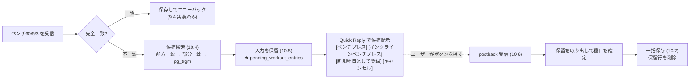
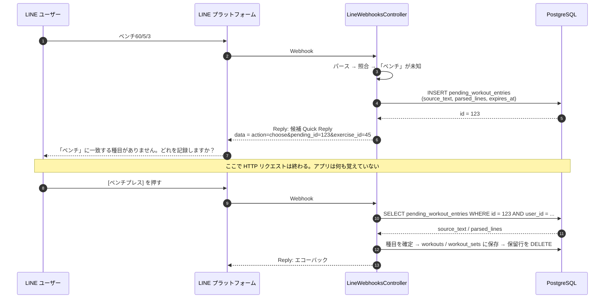
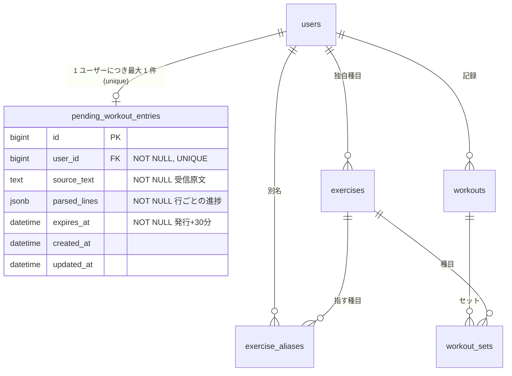
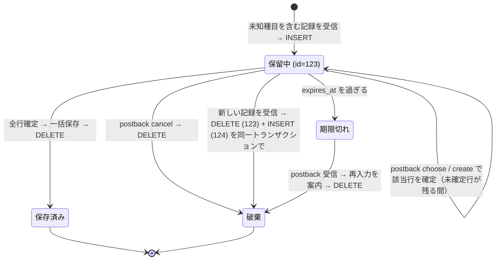
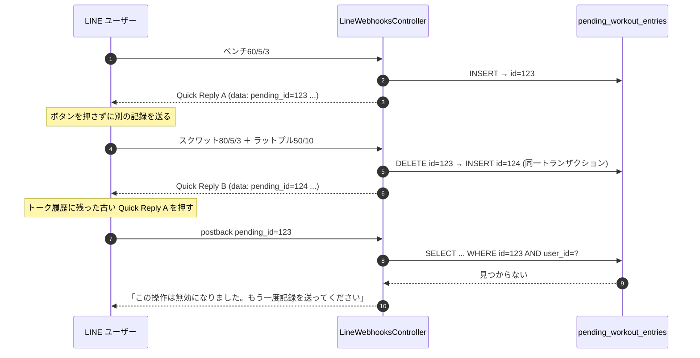
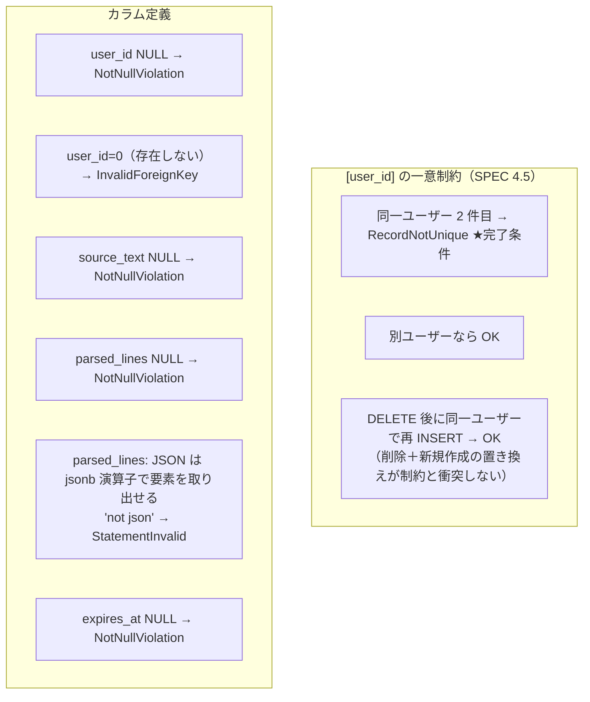
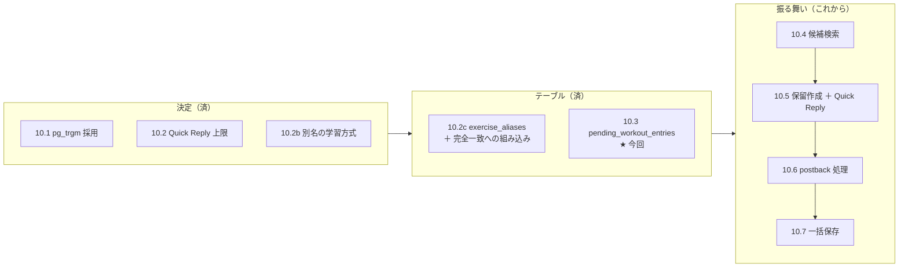

# `pending_workout_entries` テーブルの作成（plan.md 10.3 / 仕様書 4.3.1(3)・4.5）

LINE で `ベンチ60/5/3` のように**登録されていない種目名**を送ったとき、候補を Quick Reply で提示してユーザーの選択を待つ間、元の入力を預かっておくための「保留テーブル」を作った記録。
対象は 2026-10-20 時点（ブランチ `feat/f03-pending-entries-table`・plan.md 10.3）の変更。モデルや保留の作成・postback の処理はまだ無く、**今回はテーブルと DB 制約のみ**。

- 変更ファイル: `db/migrate/20261020090000_create_pending_workout_entries.rb`、`db/schema.rb`、`spec/db/pending_workout_entries_table_spec.rb`、`plan.md`
- 前提となる決定: Quick Reply の上限とボタン構成は [`docs/line-quick-reply-limits.md`](./line-quick-reply-limits.md)、候補検索は [`docs/exercise-candidate-search.md`](./exercise-candidate-search.md)、別名の学習は [`docs/exercise-alias-decision.md`](./exercise-alias-decision.md)
- 現在の記録フロー（保留が無い状態）は [`docs/line-record-flow.md`](./line-record-flow.md)
- 図は Mermaid。GitHub 上でそのまま描画される

---

## 0. 具体例で追う（まずここを読む）

1 人のユーザーの操作を時系列で追い、各時点で DB に何が入っているかを示す。以降の章はこの例の「理由」を補足するもの。

**前提**

- 田中さん（`users.id = 7`）
- プリセット種目: ベンチプレス（`exercises.id = 1`）、インクラインベンチプレス（`id = 2`）、スクワット（`id = 10`）
- 「ベンチ」という種目は登録されていない

### 例 1: 保留テーブルが無いと何が困るか

20:00 に田中さんが LINE で 2 行送る。

```
ベンチ60/5/3
スクワット80/5/3
```

アプリはパースして種目を照合する。

| 行 | 種目名 | 照合結果 |
|---|---|---|
| 1 | ベンチ | 一致なし（「ベンチプレス」とは完全一致しない） |
| 2 | スクワット | `exercises.id = 10` |

1 行目が未知なので保存できない。仕様では「候補を出して選ばせる」ので、こう返信する。

```
「ベンチ」に一致する種目がありません。どれを記録しますか？
[ベンチプレス] [インクラインベンチプレス] [新規種目として登録] [キャンセル]
```

ここで HTTP リクエストが終わる。アプリは「60kg 5 回 3 セットと書いた」ことも「2 行目はスクワットだった」ことも、もう覚えていない。

20:03 に田中さんが [ベンチプレス] を押すと、LINE からアプリに届くのはボタンに仕込んだ文字列だけ。

```
action=choose&pending_id=123&exercise_id=1
```

「ベンチプレスを選んだ」ことは分かるが、**60/5/3 もスクワットの行もこの中には無い**。これを 3 分前の入力と結びつけるために、20:00 の時点で入力を DB に預けておく。その預かり所が `pending_workout_entries`。

### 例 2: 20:00 の時点で入る行

| 列 | 値 |
|---|---|
| id | 123 |
| user_id | 7 |
| source_text | `ベンチ60/5/3\nスクワット80/5/3`（原文そのまま） |
| parsed_lines | 下の JSON |
| expires_at | 20:30（発行 + 30 分） |

```json
[
  {"line": 1, "name": "ベンチ",     "groups": [{"weight_kg": 60, "reps": 5, "sets": 3}], "exercise_id": null},
  {"line": 2, "name": "スクワット", "groups": [{"weight_kg": 80, "reps": 5, "sets": 3}], "exercise_id": 10}
]
```

1 行目の `exercise_id` が `null` なのが「まだ決まっていない行」。JSON の中身の形は 10.5 で決めるので、ここは説明用の例。ボタンの `pending_id=123` はこの行の `id` を指す。

### 例 3: 20:03 にボタンが押されたときの処理

1. `pending_id=123` かつ `user_id=7` の行を探す。見つかり、20:30 より前なので有効
2. `parsed_lines` の 1 行目に `exercise_id: 1` を書く
3. 全行が決まったので、ベンチプレス 60×5 を 3 セット、スクワット 80×5 を 3 セットを `workout_sets` に保存
4. 行 123 を削除
5. エコーバックを返信

複数行でも 1 回のボタン操作で全部保存できるのは、2 行目の内容が `parsed_lines` に残っていたから。

### 例 4: なぜ「1 ユーザー 1 行」を DB の unique index にするのか

田中さんがボタンを押さず、20:05 に別の記録を送ったとする。

```
ラットプル50/10/3
```

「ラットプル」も未知なので新しい保留が必要。仕様は後勝ちなので、古い保留は捨てる。

| 時刻 | 操作 | テーブルの中身 |
|---|---|---|
| 20:00 | INSERT | id=123（ベンチ） |
| 20:05 | DELETE 123 → INSERT | id=124（ラットプル） |

unique index が無いと、アプリのバグや並行処理で 123 と 124 が両方残り、田中さんに 2 つの質問が同時に出て、どちらのボタンがどの入力に対応するのか崩れる。「1 人につき最大 1 行」を DB が強制していれば、アプリ側に穴があっても 2 行目は作れない。

並行処理の例: 20:05:00 に「ラットプル50/10/3」、20:05:01 に「デッド100/3/3」と連投し、サーバーの 2 プロセスが同時に処理したとする。両方とも「保留が無い」と判断して INSERT しようとし、片方が unique 違反で失敗する。失敗した方は 500 を返して LINE に再送させれば、再送時には先の保留を見て正しく置き換えられる。

### 例 5: なぜ UPDATE ではなく「削除 → 新規作成」なのか

例 4 で、もし行 123 を UPDATE で書き換えて id を 123 のまま使い回したとする。

| 時刻 | 行 123 の中身 |
|---|---|
| 20:00 | ベンチ 60/5/3 |
| 20:05 | ラットプル 50/10/3（UPDATE で上書き） |

20:00 に出た古いボタン [ベンチプレス] は `pending_id=123&exercise_id=1` を持っている。田中さんが PC 版 LINE に残っていたこの古いボタンを 20:06 に押すと、アプリは「行 123 の未確定行をベンチプレスにする」と解釈する。行 123 は今ラットプルの入力なので、**50kg 10 回 3 セットがベンチプレスとして保存される**。

削除 → 新規作成なら、行 123 は存在せず 124 だけがある。古いボタンの `pending_id=123` は「該当なし」になり、「この操作は無効になりました。もう一度送ってください」と返せる。id を捨てることが、古いボタンを安全に無効化する仕組み。

### 例 6: 期限切れ

20:00 の質問に田中さんが 20:45 に答えた場合、行 123 は残っているが `expires_at`（20:30）を過ぎている。「時間が経ったのでもう一度送ってください」と返し、行を削除する。この判定のために `expires_at` を列として持つ。

### 今回のブランチで作ったのはどこまでか

上の例のうち、**実際に動くようになったのは「例 2 の行を入れられるテーブルがあること」だけ**。

| 例 | 実装状況 |
|---|---|
| 例 2 の行が入る、同じユーザーの 2 行目は拒否される、消せば入れ直せる | 今回（テーブル + spec 9 件） |
| 例 1・3 の候補返信とボタン処理 | 10.5・10.6 |
| 例 4・5 の置き換え | 10.5 |
| 例 6 の期限切れ | 10.6 |

spec は生 SQL で「例 4 で 2 行目を INSERT したらエラーになるか」「DELETE してから INSERT し直せるか」「`parsed_lines` に JSON でない文字列を入れたら拒否されるか」などを DB に直接確かめている。モデルがまだ無いので、Ruby のクラスを通さず SQL で検証している。

---

## 1. 背景: なぜ「保留」を DB に持つ必要があるのか

### 1.1 いまの実装は未知の種目で止まっている

9.4 までの `RecordMessageHandler` は、入力行の種目名が完全一致（独自種目 → 確認済み別名 → プリセット）しないと `:unknown_exercises` を返す。コントローラはこの結果に対して**返信しない**（`reply_text_for` が nil を返す）。ここが 10 章「種目候補提案」の置き場所で、仕様書 4.3.1 は次の流れを定めている。



### 1.2 Webhook は 2 回に分かれる。間を埋める置き場所が要る

LINE Bot の処理は 1 メッセージ ＝ 1 HTTP リクエストで完結し、リクエストを跨いで状態を持たない。「候補を提示する」リクエストと「ボタンが押された」リクエストは別物で、しかも間に数秒〜数十分の空白がある。



Webhook #2 に届くのは「pending_id=123 の行の種目を exercise_id=45 にする」という識別子だけ。**重量・回数・セット数・他の行の内容は Webhook #1 の入力にしか無い**ので、それを #2 まで持ち越す器が `pending_workout_entries`。

postback の `data` に入力そのものを載せない理由は、上限 300 文字（10.2 で確認）と「ユーザー入力を data に含めない」方針による。複数行入力をそのまま載せると簡単に溢れる。

---

## 2. テーブル定義と、それぞれをそう決めた理由

### 2.1 ER 図（今回追加分を強調）



`pending_workout_entries` は `exercises` や `workouts` への FK を持たない。保留中の種目の対応づけ（どの行がどの `exercise_id` に確定したか）は `parsed_lines` の中に持ち、全行が確定した時点で初めて `workouts` / `workout_sets` に書き込む（部分保存しない方針・仕様書 4.2.3）。

### 2.2 カラムと制約の根拠

| カラム / 制約 | 定義 | そう決めた理由 |
|---|---|---|
| `user_id` | FK(users)・NOT NULL | 保留は必ず誰かのもの。`current_user` 起点で引ける（CLAUDE.md のデータ分離） |
| **unique index `[user_id]`** | 1 ユーザー 1 行 | 「後勝ち」（新しい記録を送ったら古い保留は破棄）を**アプリの if 文ではなく DB 制約**で担保する。並行受信（LINE の再送・連投）でアプリ側の存在チェックをすり抜けても 2 行目は作れない（仕様書 4.3.1(3)・4.5） |
| `user_id` の単独 index | 作らない（`index: false`） | unique index が `user_id` 単独の index を兼ねる。`exercise_aliases`（10.2c）・`exercises`（3.2）と同じ判断 |
| `source_text` | text・NOT NULL | 受信した原文。再パースや返信文（「『ベンチ』に一致する種目が…」）に使う。string ではなく text なのは複数行入力をそのまま入れるため |
| `parsed_lines` | jsonb・NOT NULL | パース済みの各行（種目名・重量/回数/セット）と「どの行がどの種目に確定済みか」の進捗。1 行ずつ順に候補確認するので、途中経過を行単位で持つ必要がある（後述 2.3） |
| `expires_at` | datetime・NOT NULL | 発行から 30 分（案）。期限切れ後の postback には再入力を案内する。`created_at + 30.minutes` を毎回計算せず、期限を変えても判定が 1 か所で済むよう列として持つ |
| `created_at` / `updated_at` | timestamps | Rails 標準。`updated_at` は現状の設計（UPDATE しない）では実質使わないが、標準構造を崩さない |

### 2.3 `parsed_lines` を jsonb にした理由（子テーブルにしなかった理由）

行ごとの進捗なら `pending_workout_entry_lines` のような子テーブルも考えられるが、採らなかった。

| 観点 | jsonb 1 列 | 子テーブル |
|---|---|---|
| 寿命 | 最長 30 分で物理削除。履歴や集計に使わない | 同じ |
| 検索 | `id` と `user_id` でしか引かない。行の中身で検索しない | JOIN が増えるだけ |
| 置き換え | 親 1 行の DELETE → INSERT で済む | 子行の削除も必要（FK の cascade 設定が要る） |
| 内部構造 | **10.5 で確定**。今は決め打ちしない方がよい | 列を今決める必要があり、変更のたびにマイグレーション |

短命・検索しない・構造が未確定の 3 点が揃うので、jsonb に寄せた。spec では「jsonb として格納され JSON でない文字列は拒否される」ことまでを確認し、中身の構造は検証していない（10.5 の仕事）。

---

## 3. 保留の一生（なぜ UPDATE ではなく「削除 → 新規作成」なのか）

仕様書 4.3.1(3) は、保留の置き換えを**既存行の物理削除 → 新しい id で新規作成**と定め、UPDATE による書き換えを禁じている。これは「古い Quick Reply のボタンを無効化する」ための仕掛け。



### 3.1 id 再採番で stale postback が無効になる仕組み



もし UPDATE で `id=123` を使い回すと、古いボタン A の postback が新しい保留 B（スクワットの入力）に対して「ベンチプレスにする」と解釈され、**無関係な入力に別の種目を割り当てる**。id を捨てることで、古いボタンは「対応する保留が無い」として安全に弾ける。

`exercise_aliases` の未確認行（10.2b）も同じ理由で削除＋新規作成にしており、設計の一貫性がある。

### 3.2 unique index と置き換えの関係

「DELETE → INSERT を同一トランザクションで行う」前提なら、トランザクションの中では常に 0 行か 1 行で、unique 制約は normal path では当たらない。制約が効くのは**並行して 2 つの Webhook が同じユーザーの保留を作ろうとしたとき**で、片方が `RecordNotUnique` で失敗する。これは 4.2.4 の「500 を返して LINE に再送させる」で回復できる（方式は 10.5 で確定）。

spec の「削除後に同一ユーザーで再登録できる」example は、この DELETE → INSERT が unique 制約と衝突しないことを固定している。

---

## 4. 具体的に何をしたか

### 4.1 マイグレーション

```ruby
class CreatePendingWorkoutEntries < ActiveRecord::Migration[8.1]
  def change
    create_table :pending_workout_entries do |t|
      t.references :user, null: false, foreign_key: true, index: false  # unique index が index を兼ねる
      t.text :source_text, null: false                                   # 受信原文
      t.jsonb :parsed_lines, null: false                                 # 行ごとの進捗（構造は 10.5）
      t.datetime :expires_at, null: false                                # 発行 + 30 分
      t.timestamps
    end

    add_index :pending_workout_entries, :user_id, unique: true           # 1 ユーザー 1 保留
  end
end
```

`db/schema.rb` の差分は **テーブル追加・FK 追加・version 更新の 3 点のみ**。PR #81 で「schema.rb に無関係な列順の差分が混ざった」反省（Rails 8.1.4 の dumper 変更が原因）から、コミット前に `git diff db/schema.rb` を見て余計な差分が無いことを確認している。

### 4.2 spec（9 examples）: モデルが無いので生 SQL で DB 制約を検証する

`PendingWorkoutEntry` モデルは 10.5 で作るため、今回はモデル経由ではなく `INSERT` 文を直接発行して**DB が拒否するか**を確認する。`exercises_table_spec` / `workouts_table_spec` / `processed_line_events_table_spec` と同じ方針。



TDD の順序: spec を先に書いて実行 → `PG::UndefinedTable`（RED）→ マイグレーション作成・適用 → 9 examples GREEN。全体では RSpec 369 examples・0 failures、RuboCop 指摘なし。

### 4.3 今回「やっていない」こと（次の項目の範囲）

| やっていないこと | どこでやるか |
|---|---|
| `PendingWorkoutEntry` モデル・検証・`User has_one :pending_workout_entry` | 10.5 |
| `parsed_lines` の中身の構造 | 10.5 |
| 保留の作成・置き換え・Quick Reply の返信 | 10.5 |
| postback の処理（choose / create / cancel・stale・期限切れ） | 10.6 |
| 全行確定時の一括保存と保留行の削除 | 10.7 |
| 期限切れ行の定期削除 | 未決。Stage 1 は非同期ジョブ無しのため、postback 受信時に判定して消す運用が有力 |

---

## 5. 全体の中での位置づけ

10 章の作業は「決定（10.1〜10.2b）→ 土台のテーブル（10.2c・**10.3**）→ 振る舞い（10.4〜10.7）」の順に積む。今回でテーブルが 2 つとも揃い、次からロジックに入る。



---

## 6. 作業中の気づき（次回のための備忘）

- **テスト DB のマイグレーションがロック待ちで止まった（2 回目）。** 原因は、別ターミナルに残っていた `rspec` プロセスが `pp` で停止したままトランザクションを 4 日間開いていたこと。spec 内でデバッガや `pp` で止めたら、終了時に必ずプロセスを抜ける。止まったら `SELECT pid, state, query FROM pg_stat_activity` で犯人を探す
- **schema.rb の差分はコミット直前に見る。** 実装直後の diff と、テスト DB 準備で再 dump された後の diff は別物になり得る（PR #81 の教訓）
