# 筋トレ管理アプリ 図入り仕様書・実装フロー・現在地

- 作成日: 2026-11-10 ／ 最終更新日: 2026-11-18（この日時点の `plan.md` と仕様書 版 3.6 をもとに更新）
- 元資料: `plan.md`（実装計画と進捗の一次記録）／ `~/plans/SPEC-workout-tracker-20260723.md`（詳細仕様書）
- 対象読者: エンジニア、および初めてこのアプリを知る非エンジニアの方
- 専門用語には初出時に短い説明を付け、末尾の[用語集](#7-用語集)にまとめています

---

## 0. 30 秒でわかるまとめ

| 問い | 答え |
|---|---|
| 何を作っている？ | **LINE に「ベンチプレス60/5/3」と送るだけで筋トレを記録でき、Web でグラフを見られるアプリ** |
| 全体の計画は？ | 3 段階。**Stage 1**（記録とグラフ）→ Stage 2（AI の提案と通知）→ Stage 3（自由な文章での入力など） |
| いまどこ？ | **Stage 1 の終盤。73 項目中 60 項目が完了（約 82%）** |
| いま何ができる？ | LINE での記録（知らない種目名は候補から選ぶ・新規登録する・略称を覚えさせる、まで）、Web でのログイン・記録の閲覧と編集・グラフ表示 |
| 次にやることは？ | **項目 11.1「ヘルプ コマンド」**。その後、今日・履歴のコマンド、メニュー、実機での通し確認 |

```
Stage 1 全体の進み具合   ████████████████░░░░  60 / 73 項目（約 82%）
```

---

## 1. このアプリは何をするものか

ジムや自宅でトレーニングした直後に、スマホの LINE から 1 行送るだけで記録が残ります。溜まった記録は、パソコンやスマホのブラウザでグラフとして振り返れます。

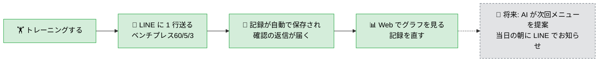

緑＝ Stage 1 の範囲（ほぼ完成）、灰色の点線＝ Stage 2 以降の予定です。

**大事な考え方が 1 つあります。「アカウント＝ LINE アカウント」です。**
会員登録の画面も、メールアドレスやパスワードもありません。LINE で Bot（自動応答アカウント）を友だち追加した時点で利用者として登録され、Web には「LINE でログイン」ボタンで入ります。どちらから始めても同じ 1 人の利用者として扱われます。

---

## 2. 現在地（どのステップまで進んでいるか）

### 2.1 3 段階の中の位置

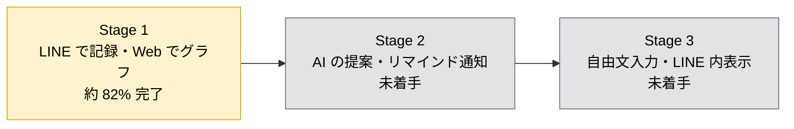

### 2.2 Stage 1 の章ごとの進み具合

`plan.md` は 12 章・73 項目で構成されています（当初 70 項目。進める中で 3 項目を追加）。✅ 完了／🔶 一部残り／⬜ 未着手。

| 章 | 内容（やさしい言い方） | 進み具合 | 完了 / 全体 | 状態 |
|---|---|---|---|---|
| 1 | 開発の土台づくり | `██████████` | 4 / 4 | ✅ |
| 2 | ログインの仕組み（初代。後に 8 章で置き換え） | `██████████` | 5 / 5 | ✅ |
| 3 | 種目の一覧表（ベンチプレス等 22 種目） | `██████████` | 5 / 5 | ✅ |
| 4 | 記録を保存する仕組み | `██████████` | 5 / 5 | ✅ |
| 5 | Web の記録画面・種目管理画面 | `██████░░░░` | 5 / 8 | 🔶 |
| 6 | グラフ（ダッシュボード） | `██████████` | 3 / 3 | ✅ |
| 7 | LINE からメッセージを受け取る土台 | `█████████░` | 7 / 8 | 🔶 |
| 8 | LINE アカウントでの登録・ログイン | `█████████░` | 10 / 11 | 🔶 |
| 9 | LINE で記録を入力する | `██████████` | 6 / 6 | ✅ |
| 10 | 知らない種目名への候補提案 | `██████████` | 10 / 10 | ✅ |
| 11 | コマンド（ヘルプ・今日・履歴）とメニュー | `░░░░░░░░░░` | 0 / 4 | ⬜ **← 次はここ** |
| 12 | 全体の通し確認 | `░░░░░░░░░░` | 0 / 4 | ⬜ |
| | **合計** | | **60 / 73** | **約 82%** |

- 直近の完了: **10.6〜10.8**（候補ボタンを押した後の処理、複数の未知種目の順次確認と一括保存、保留を作る前の検証。2026-11-18 までに PR #92・#95・#96 として main に取り込み済み）
- **次に着手: 11.1「ヘルプ コマンド」**
- 自動テストは 10.8 完了時点で 481 件すべて成功

### 2.3 残っている 13 項目

| 項目 | 内容 | 補足 |
|---|---|---|
| **11.1〜11.3** | `ヘルプ` `今日` `履歴` の 3 コマンド | **次に着手** |
| 11.4 | LINE のトーク画面下部に出るメニュー（リッチメニュー） | 実機で確認 |
| 8.10 | 「LINE でログイン」の安全設定の確認（偽のアドレス経由のログインを防ぐ設定が有効か） | 12.1 より前に実施 |
| 12.1 | 実物の LINE での通し確認 | |
| 7.7 | LINE 側の「再送」設定を有効にする | 設定画面の都合で 12.1 と同時に実施 |
| 12.2〜12.4 | 全テスト実行、仕様書との突き合わせ、残課題の棚卸し | Stage 1 完了の判定 |
| 5.6 | 同じ名前の「プリセット種目」と「自分の種目」を画面で見分けられるようにする | 見た目のみ。時期は任意 |
| 5.7 | 入力欄に名前（ラベル）を付ける | 読み上げソフト等への配慮。時期は任意 |
| 5.8 | 種目の「重量を省略できるか」の設定を、作成後にも変更できるようにする | 時期は任意 |

進める中で追加した項目は 5.8・8.10・10.8 の 3 つです（10.8 は完了済み）。

---

## 3. 図入り仕様書

各機能の横に、**いま動くか（✅）・まだか（⬜）**を付けています。

### 3.1 登場人物と全体のつながり

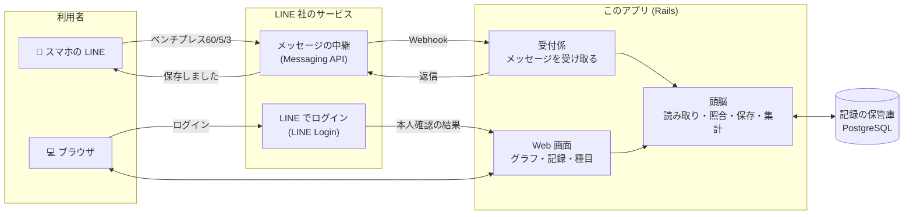

- **Webhook（ウェブフック）**: 利用者が LINE に送ったメッセージを、LINE 社がこのアプリへ転送してくる仕組み
- LINE からは**入力**、Web では**閲覧・修正・グラフ**。どちらも同じ保管庫の同じ記録を扱います
- AI など時間のかかる処理は Stage 1 には入れません（返信が遅くなるため）。受け取ったらその場で保存し、すぐ返信します

### 3.2 機能一覧と状態

| ID | 機能 | Stage | 状態 |
|---|---|---|---|
| F-01 | 利用者登録（友だち追加か初回ログインで自動作成。登録画面なし） | 1 | ✅ |
| F-02 | Web ログイン（LINE でログイン） | 1 | ✅ |
| F-03 | LINE で記録を入力 | 1 | ✅ 種目名が一致すれば即保存。一致しなければ候補から選ぶ・新規登録する |
| F-04 | 記録直後の確認返信・エラー返信 | 1 | ✅ |
| — | LINE のコマンド（ヘルプ・今日・履歴）とメニュー | 1 | ⬜（11 章） |
| F-05 | Web で記録の一覧・詳細・編集・削除 | 1 | ✅ |
| F-06 | 種目の管理（プリセット 22 種目＋自分の種目） | 1 | ✅（表示の小改善 5.6 が残り） |
| F-07 | グラフ（種目ごとの伸び・トレーニング頻度） | 1 | ✅ |
| F-08〜F-13 | 裏側で動く処理の基盤、AI の提案、LINE への通知、通知・トレーニング設定 | 2 | ⬜ |
| F-14 / F-15 | 自由な文章での入力、LINE 内でのグラフ表示 | 3 | ⬜ |

### 3.3 登録とログインの流れ ✅

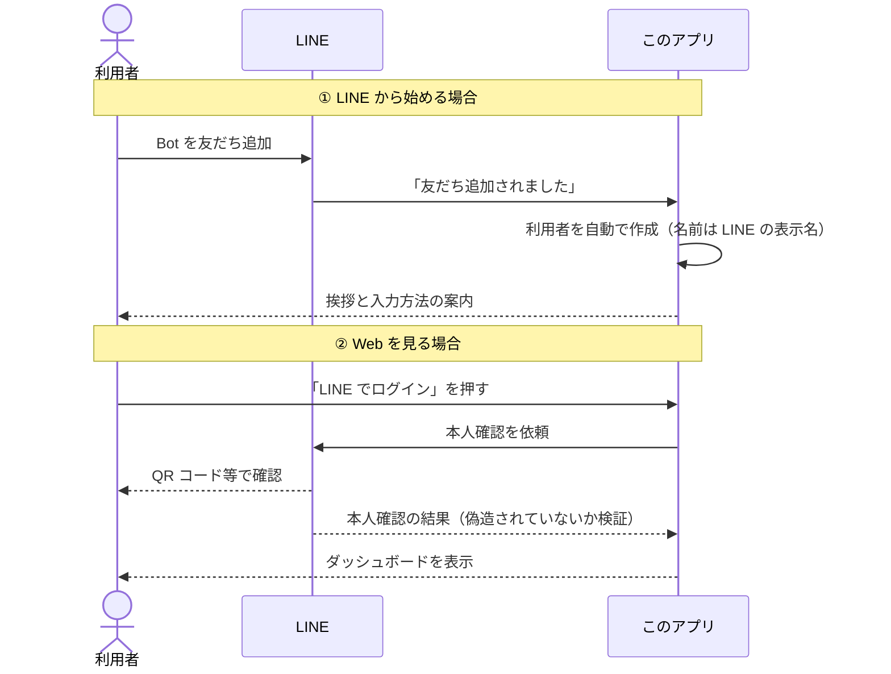

- ①と②のどちらが先でも、LINE が発行する同じ利用者 ID で**同じ 1 人**に行き着きます
- メールアドレスやパスワードはこのアプリでは保持しません
- ブロックされた場合は「ブロック中」の印を付けるだけで、記録は消しません。再度友だち追加すれば元に戻ります

### 3.4 LINE での記録の書き方 ✅

基本形は **`種目名 重量/回数/セット数`** です。

| 送る内容 | 意味 |
|---|---|
| `ベンチプレス60/5` | 60kg を 5 回、1 セット |
| `ベンチプレス60/5/3` | 60kg を 5 回、3 セット |
| `ベンチプレス60/5 65/5 70/3` | 60kg×5 回、65kg×5 回、70kg×3 回を 1 セットずつ |
| `懸垂/10/3` | 自重（重りなし）で 10 回、3 セット |
| `ベンチプレス60kg/5回/3セット` | 単位を付けても同じ意味 |

- 改行して複数の種目を一度に送れます（20 行まで）
- 全角・半角の違い、ひらがな・カタカナの違い、前後の空白は自動でそろえます（`ベンチぷれす` → `ベンチプレス`）
- **推測で直すことはしません。** 書き方が違う場合は、どの行がだめだったかと正しい例を返信します。複数行のうち 1 行でもだめなら**全部保存しません**（中途半端な記録を残さないため）
- 記録日は送った日（日本時間）。過去の日付の記録や修正は Web から行います

### 3.5 メッセージを受け取ってから返信するまで

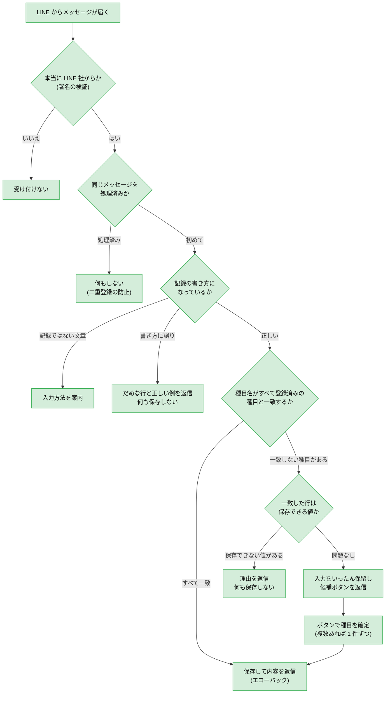

図の箱はすべて実装済みです。問題が複数あるメッセージには、「書き方の誤り → 保存できない値 → 知らない種目名」の順で、最初に当てはまったものだけを返信します。

### 3.6 知らない種目名が来たとき ✅

略称（`ベンチ`）や打ち間違いをそのまま新しい種目にすると、同じ種目が別名でいくつもできてグラフが分かれてしまいます。そこで、**利用者に確認してから**記録します。

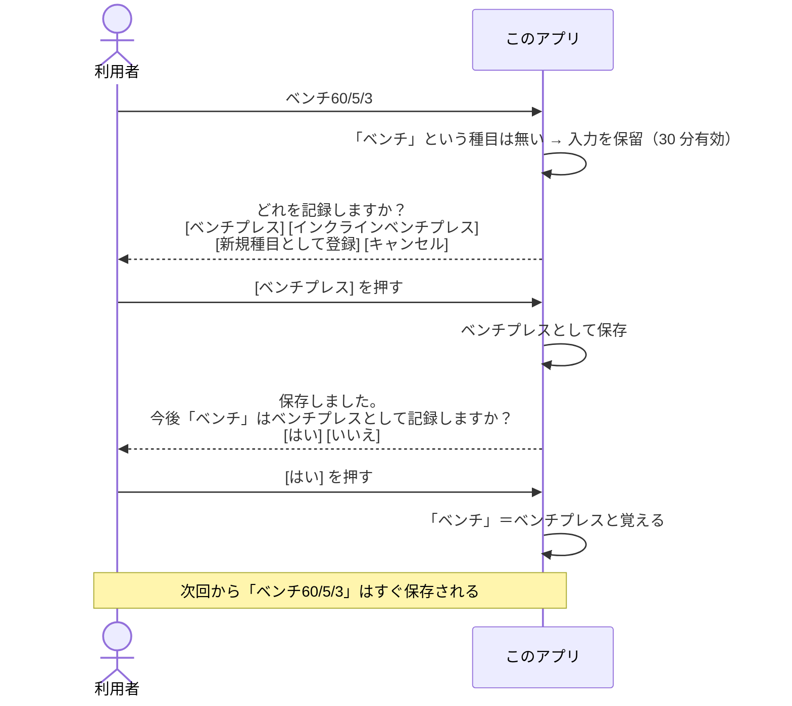

- 候補は最大 4 件。前から一致 → 途中に一致 → 文字の並びが似ている、の順で探します（打ち間違いも拾えます）
- **勝手に覚えません。** 「はい」を押したときだけ略称を覚えます。無視したり「いいえ」を押したりした場合は覚えません（人によって `ベンチ` が指す種目が違うため）
- 保留中に新しい記録を送ると、古い保留は捨てて新しい方を優先します
- 知らない種目名が複数あるときは **1 件ずつ順に確認**し、全部決まった時点でまとめて保存します。途中で「キャンセル」を押すと何も残りません（新規登録しかけた種目も作りません）。略称を覚えるかの確認も 1 件ずつ出します
- 「新規種目として登録」を選ぶと、送った名前のまま自分の種目として登録します。重量なしで送っていれば「重量を省略できる種目」、重量ありなら「重量が必須の種目」になります
- 記録日はボタンを押した日ではなく、**最初にメッセージを送った日**です。30 分の期限も最初のメッセージからで、確認を進めても延びません
- 覚えた略称の取り消し画面は Stage 1 にはありません（正式名称で送れば正しく記録できます）

### 3.7 Web の画面 ✅

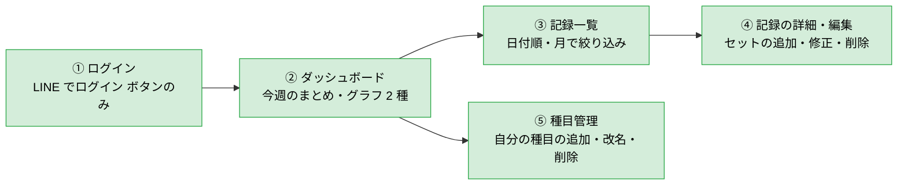

| 画面 | できること |
|---|---|
| ② ダッシュボード | 今週の実施日数と総セット数。**種目ごとの伸びのグラフ**（その日の最大重量と推定 1RM。期間は 1・3・6 か月）。**頻度のグラフ**（週または月ごとの実施日数） |
| ③ 記録一覧 | 日付の新しい順に、日付・種目数・セット数を表示 |
| ④ 記録の詳細・編集 | LINE で送り間違えた記録の修正はここで行う。セットを消すと番号は自動で詰まる |
| ⑤ 種目管理 | 記録に使われている種目は消せない（記録が宙に浮くのを防ぐため） |

- **推定 1RM**: 「1 回だけなら何 kg 挙げられるか」の目安。`重量 × (1 + 回数 ÷ 30)` で計算します
- すべての画面はログインが必要で、**他の人の記録は一切見えません**

### 3.8 データの持ち方

保管庫の中身を表にたとえると、次の 7 つの表があります。

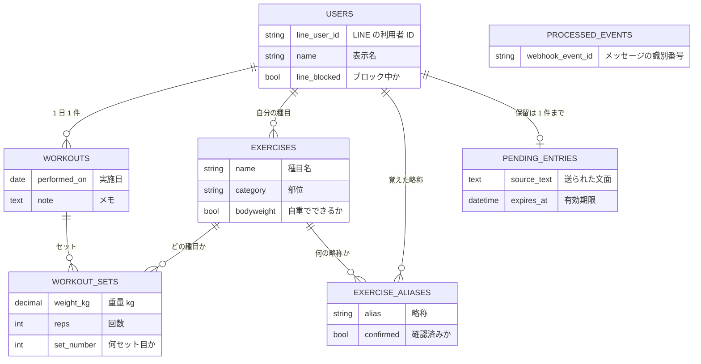

| 表（正式名） | 役割 | 状態 |
|---|---|---|
| 利用者（`users`） | LINE アカウント 1 つにつき 1 行 | ✅ |
| 種目（`exercises`） | 全員共通のプリセット 22 件＋各自の種目 | ✅ |
| トレーニング日（`workouts`） | 1 人 1 日 1 行。同じ日の記録はここに追記 | ✅ |
| セット（`workout_sets`） | 重量・回数・何セット目か | ✅ |
| 略称（`exercise_aliases`） | 「ベンチ＝ベンチプレス」の対応 | ✅ |
| 保留（`pending_workout_entries`） | 種目の確認待ちの入力 | ✅ |
| 処理済みメッセージ（`processed_line_events`） | 二重登録を防ぐための控え | ✅ |

### 3.9 安心して使うための仕組み ✅

| 心配ごと | 対策 |
|---|---|
| 他人に記録を見られないか | 全画面でログイン必須。データは必ず「ログイン中の本人のもの」から探すため、他人の記録には届かない |
| なりすましのメッセージ | LINE 社の署名を検証し、合わないものは受け付けない |
| 同じ記録が二重に入らないか | LINE は通信が不安定だと同じメッセージを再送する。メッセージごとの識別番号を控えておき、2 回目は無視する |
| 障害で記録が消えないか | アプリ側で失敗したら「失敗」と LINE に伝え、LINE の再送で取り戻す。上の仕組みがあるので二重にはならない |
| 返信が届かなかったら | 返信は保存の完了後に送る。返信に失敗しても保存済みの記録は残る |
| 中途半端な記録 | 複数行のうち 1 行でも問題があれば全行を保存しない |

注意点: 返信が届かず、利用者が**同じ内容を手で送り直した**場合は 2 回分として保存されます（同じ重量・回数をもう 1 セット行うのは普通にあるため、内容での重複判定はあえてしていません）。Web の編集画面で直せます。

### 3.10 この先の予定（Stage 2・3）⬜

| Stage | 内容 |
|---|---|
| 2 | トレーニング設定（鍛えたい部位・できない曜日）を登録 → AI が記録を分析して次回メニュー・休息期間・次回日を提案 → LINE に通知。当日の朝には「今日は脚のトレーニングの日です」とお知らせ。通知のオン/オフと時刻は変更可能 |
| 3 | 「今日はベンチ 60 キロを 5 回 3 セットやった」のような自由な文章での入力。LINE アプリ内でグラフを表示 |
| 構想のみ | LINE 以外のチャットアプリ（WhatsApp 等）への展開。計画は立てていない |

AI の提案は参考情報であり、医学的な助言ではない旨を利用者に明示する方針です。

---

## 4. 実装フロー図

### 4.1 Stage 1 を作る順番と現在地

土台から順に積み上げています。矢印は「これができてから次へ」の関係です。

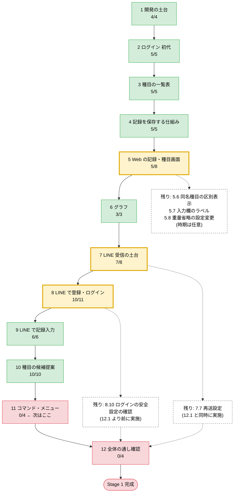

緑＝完了、黄＝一部残り、赤＝未着手。

途中で 1 度、大きな方針変更がありました（2026-09-03）。当初は「メールアドレスとパスワードで会員登録し、後から LINE とつなぐ」方式で 2 章と 8 章の前半を作りましたが、「友だち追加だけで使い始められる」ことを優先して **LINE でのログインに一本化**し、作り直しています。2 章が「初代」となっているのはこのためです。

### 4.2 10 章（直近に完了した章）の内訳

```mermaid
flowchart LR
    A["10.1 似た名前の探し方を決定"] --> B["10.2 ボタンの上限を確認"]
    B --> C["10.2b 略称の覚え方を決定"]
    C --> D["10.2c 略称の表を作成"]
    D --> E["10.3 保留の表を作成"]
    E --> F["10.4 候補を探す処理"]
    F --> G["10.5 保留して候補ボタンを返信"]
    G --> H["10.6 ボタンを押した後の処理"]
    H --> I["10.7 複数の未知種目を<br/>順に確認して一括保存"]
    I --> J["10.8 保存できない値を<br/>候補の前に知らせる"]

    classDef done fill:#d4edda,stroke:#28a745,color:#000
    class A,B,C,D,E,F,G,H,I,J done
```

10.8 は、10.6 を作る中で見つかった改善点（どう答えても保存できない入力に、候補の質問を挟んでいた）を後から項目として追加し、対応したものです。

### 4.3 1 つの項目を仕上げる手順

どの項目も同じ手順で進めています。「先にテストを書く」のが特徴です。

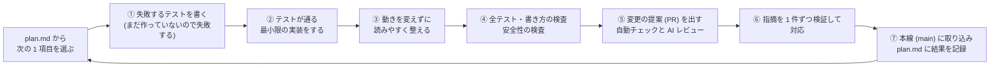

- **テスト**: 「こう動くはず」をプログラムで書いた自動チェック。後の変更で壊れていないかをいつでも確かめられます
- **PR（プルリクエスト）**: 変更を本線に入れる前に、内容を確認してもらうための提案
- 1 項目＝ 1 つの PR に小さく区切り、決めたこととその理由を `plan.md` に残しています

### 4.4 これまでの歩み

| 時期 | 章 | できたこと |
|---|---|---|
| 7 月下旬 | 1 | 開発環境、自動チェックの仕組み |
| 7 月末〜8 月上旬 | 2 | ログイン（初代・メールとパスワード） |
| 8 月上旬〜中旬 | 3・4 | 種目の一覧表、記録を保存する仕組み |
| 8 月下旬 | 5・6 | Web の記録画面、種目管理、グラフ |
| 8 月末〜9 月初め | 7 | LINE からメッセージを受け取る土台（署名検証・二重登録防止） |
| 9 月上旬 | 8 | **LINE ログインへ一本化**、友だち追加での自動登録 |
| 9 月 | 9.1〜9.4 | 記録の書き方を確定、読み取り、保存と確認返信 |
| 10 月 | 9.5〜10.2b | エラー時の返信、候補提案の方式を決定（探し方・ボタン・略称） |
| 10 月〜11 月上旬 | 10.2c〜10.5 | 略称の表、保留の表、候補探し、候補ボタンの返信（11/8） |
| 11 月中旬 | 10.6〜10.8 | ボタン後の処理、複数種目の順次確認と一括保存、略称の学習、保存できない値の先回り検出（11/18） |
| **これから** | 11〜12 | コマンド、メニュー、実機での通し確認 |

---

## 5. Stage 1 完成までの道のり

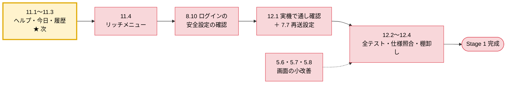

12.1 の通し確認では、実物の LINE で「友だち追加 → 記録 → 書き間違いの解決 → 候補から選ぶ → 今日・履歴 → パソコンで LINE ログイン → グラフと編集 → ブロックと再追加」を一通り試します。

---

## 6. まだ決まっていないこと

仕様書 10 章の未確定事項のうち、残っているものです。

| # | 事項 | 決める時期 |
|---|---|---|
| 1 | どこで公開運用するか（ホスティング先）と月額予算 | Stage 1 完成前後 |
| 15 | 退会（アカウント削除）の方法 | Stage 1 完成前後（12.4 で方針決定） |
| 13 | 時間で測る種目（プランク等）の記録方法 | Stage 2 以降 |
| 14 | Web に先にログインしたが Bot を友だち追加していない人の扱い | Stage 2 詳細化時 |
| 2・7 | どの AI を使うか、AI への指示文の設計と評価方法 | Stage 2 着手時 |
| 6・11 | 定時通知の仕組みの選定、トレーニング設定の項目詳細 | Stage 2 詳細化時 |

---

## 7. 用語集

| 用語 | 意味 |
|---|---|
| Bot（ボット） | LINE 上で自動的に返信するアカウント |
| Webhook | 利用者のメッセージを LINE 社がこのアプリへ転送してくる仕組み |
| LINE Login | LINE アカウントで他のサービスにログインする公式の仕組み |
| Quick Reply | LINE のメッセージの下に出る選択ボタン |
| postback | Quick Reply のボタンが押されたことをアプリに知らせる通知 |
| エコーバック | 保存した内容をそのまま返信して確認してもらうこと |
| プリセット種目 | 最初から用意されている全員共通の 22 種目 |
| 自重 | 重りを使わず自分の体重だけで行うこと（懸垂・腕立て伏せ等） |
| 推定 1RM | 1 回だけ挙げられる最大重量の推定値 |
| 冪等性（べきとうせい） | 同じ処理が 2 回届いても結果が 1 回分になる性質。二重登録の防止 |
| 保留 | 種目名の確認が済むまで、入力を保存せずに一時的に預かること |
| Rails / PostgreSQL | このアプリを作っている開発の枠組み／データの保管庫 |
| テスト（RSpec） | 動作を自動で確かめるプログラム |
| PR | 変更を本線に取り込む前の確認用の提案 |
| Stage | 開発の大きな段階（1〜3） |

---

## 8. もっと詳しく知りたいとき

| 資料 | 内容 |
|---|---|
| `plan.md` | 全 73 項目の実施内容・完了条件・決定の理由（一次記録） |
| `~/plans/SPEC-workout-tracker-20260723.md` | 詳細仕様書（版 3.6。リポジトリ外） |
| `~/plans/DECISION-line-login-unification-20260903.md` | LINE ログイン一本化の経緯 |
| `docs/line-record-flow.md` | LINE 記録入力の処理の詳細（エンジニア向け） |
| `docs/exercise-candidate-search.md` / `docs/exercise-alias-decision.md` / `docs/line-quick-reply-limits.md` | 候補提案に関する調査と決定の記録 |
| `docs/stage1-progress-overview.md` | 9.4 時点のエンジニア向け進捗まとめ（本資料より古い） |
